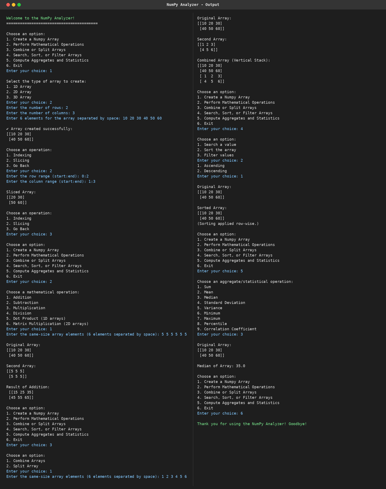

# 🧮 NumPy Analyzer

## 📖 Project Description

NumPy Analyzer is a **menu-driven console application** built with **Python**, **NumPy** and **Object-Oriented Programming (OOP)**. It allows users to create 1D, 2D and 3D arrays and perform common data operations, mathematical computations and statistical analysis on them, all through a simple text menu.

---

## ✨ Features

- 📦 Create **1D, 2D and 3D** arrays
- 🔍 **Indexing** and ✂️ **Slicing** of arrays
- 🔗 **Combine** arrays (vertical stack) and 🪓 **Split** arrays
- ➗ Element-wise **Addition, Subtraction, Multiplication, Division**
- ✖️ **Dot Product** (1D) and **Matrix Multiplication** (2D)
- 🎯 **Search** a value in the array
- 🔼🔽 **Sort** in ascending or descending order
- 🧹 **Filter** values (less than / greater than / equal to)
- 📊 **Statistics:** Sum, Mean, Median, Standard Deviation, Variance, Minimum, Maximum, Percentile, Correlation Coefficient
- 🛡️ Input validation and error handling
- 🚪 Easy exit option from the main menu

---

## 🛠️ Technologies Used

- 🐍 **Python 3.8+**
- 🔢 **NumPy**
- 🧱 **OOP Concepts:** Class, Constructor, Encapsulation, Private Methods, `@classmethod`, `@staticmethod`

---

## 🚀 How to Run / Installation

**1️⃣ Make sure Python is installed**
```bash
python --version
```

**2️⃣ Download the project and open its folder in the terminal**
```bash
cd numpy-analyzer
```

**3️⃣ Install NumPy**
```bash
pip install numpy
```

**4️⃣ Run the program**
```bash
python numpy_analyzer.py
```

---

## 🗂️ Project Structure


 ┣ 📄 main.py 
 ┣ 🖥️ output.png  
 ┗ 📄 README.md           

## 🖥️ Output / Screenshots :

---

## 👨‍💻 Author / Developer

**Kunal Vaghela**